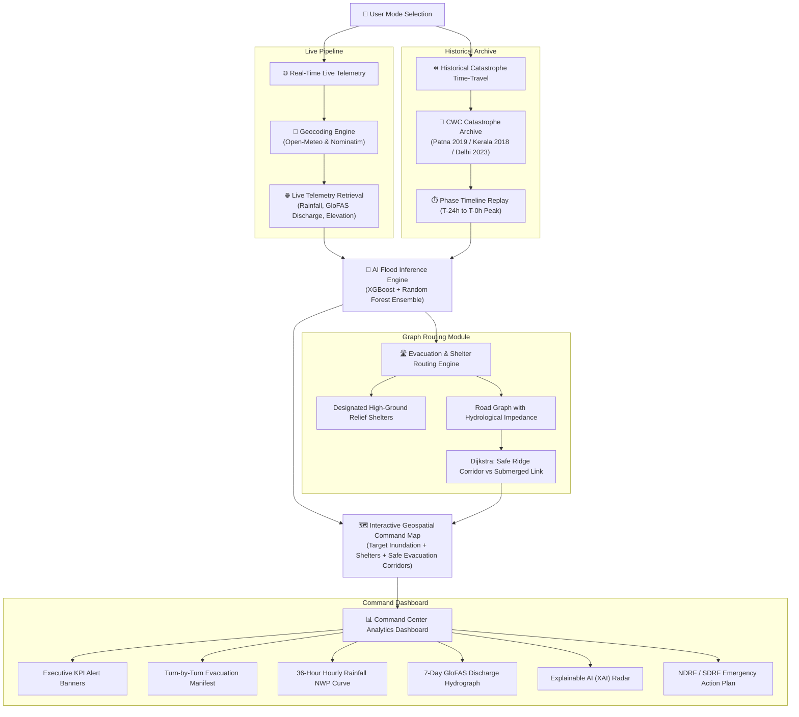

# 🌊 Smart Flood Risk Prediction & Disaster Response Command Center

> **7th Semester B.Tech Major Capstone Group Project in Computer Science & Engineering**  
> An automated, end-to-end AI and geospatial decision-support platform integrating hydrometeorological telemetry, early warning classification, **Dijkstra-based safe evacuation pathfinding**, and **historical catastrophe stress-testing**.

---

## 📌 Project Overview
Floods cause devastating humanitarian and economic losses annually across vulnerable river basins and urban corridors. While standard weather applications merely display ambient rain forecasts, this system functions as an **Operational Disaster Command & Evacuation Support System**:
1. **Live Global Telemetry & Geocoding**: Queries Open-Meteo High-Resolution Weather, GloFAS River Discharge, and Open-Elevation with zero API keys required.
2. **High-Accuracy ML Ensemble**: Trained on 10,000 hydrometeorological records using calibrated **XGBoost + Random Forest** models aligned with Central Water Commission (CWC) and IMD thresholds.
3. **🛣️ AI Safe Evacuation Pathfinding Engine**: Evaluates local road network graphs using **Dijkstra's Shortest Path Algorithm with Hydrological Edge Impedance**. Dynamically detects submerged road links and calculates alternative high-elevation corridors to designated emergency relief shelters.
4. **⏪ Historical Catastrophe Time-Travel & Replay**: Allows interactive stress-testing and phase-by-phase playback of major Indian flood disasters (**Patna 2019 Urban Deluge, Kerala 2018 Mega Floods, and Delhi Yamuna 2023 Record Breach**).
5. **Interactive Multi-Layer Geospatial Command Map**: Built with **Folium & Leaflet**, highlighting inundation danger zones, peripheral monitoring stations, relief camps, and color-coded safe vs. submerged evacuation routes.
6. **Executive Dashboard & Analytics**: Features Explainable AI (XAI) factor radar charts, 36-hour precipitation forecasts, 7-day river discharge hydrographs, and instant export of assessment manifests in JSON and CSV.

---

## 🏗️ System Architecture



---

## 🚀 Key Academic & Engineering Highlights

### 1. 🛣️ AI Safe Evacuation Pathfinding (`evacuation_engine.py`)
- Standard navigation engines route through the shortest road, often leading civilians into deadly flooded underpasses.
- This module implements Dijkstra search where edge travel impedance is scaled by road elevation and calculated water inundation depth:
  $$\text{Edge Cost} = \text{Distance} \times \left(1 + \text{Penalty}_{\text{submergence}}\right) + \text{Elevation Cost}$$
- Provides turn-by-turn waypoint guidance (Road type, elevation, water depth, and passability status) and connects to pre-mapped high-elevation relief camps.

### 2. ⏪ Historical Catastrophe Time-Travel (`historical_scenarios.py`)
- Addresses the "Dry-Day Presentation Problem" where live APIs show $0\text{ mm}$ rain during clear weather.
- Pre-calibrated historical stages for real disasters:
  - **Patna 2019 Urban Deluge**: $342\text{ mm}$ rainfall, Ganga sluice backflow, $50.52\text{ m}$ record level.
  - **Kerala 2018 Mega Floods**: 35 major dams opened, $4,450\text{ m}^3/\text{s}$ discharge into Periyar river.
  - **Delhi Yamuna 2023 Breach**: Hathnikund Barrage release, shattering 45-year record to reach $208.66\text{ m}$ MSL.

### 3. 🗺️ Multi-Layer Geospatial Command Map (`map_view.py`)
- **Pulsing Inundation Radar Halo**: Primary impact zone centered on target coordinates.
- **Relief Camp Markers**: Highlights capacity, available beds, and medical ICU readiness.
- **Evacuation Paths**:
  - 🟢 **Solid Emerald Corridor**: AI-selected high-ground safe path ($100\%$ clear).
  - 🔴 **Red Dashed Polyline**: Hazardous direct path highlighting submerged road chokepoints.

---

## 📂 Repository File Structure

```
├── app.py                      # Main Streamlit command dashboard application
├── evacuation_engine.py        # Graph pathfinding (Dijkstra) & shelter allocation engine
├── historical_scenarios.py     # CWC historical disaster archive & timeline stages
├── flood_engine.py             # Machine learning inference & hydrological risk engine
├── api_services.py             # Geocoding, Open-Meteo weather/flood/elevation API integration
├── map_view.py                 # Interactive Folium map generation with evacuation layers
├── utils.py                    # Plotly charts, risk gauges, emergency guidelines
├── train_model.py              # ML training & model serialization script
├── test_system.py              # Automated 8-point end-to-end test suite
├── flood_model.pkl             # Serialized trained XGBoost & Random Forest artifacts
├── model_metadata.json         # Model metrics, feature importances, and encoders
├── flood_risk_dataset_corrected.csv  # Hydrological dataset (10,000 samples)
├── requirements.txt            # Python dependencies
└── README.md                   # Comprehensive project documentation
```

---

## 🛠️ Installation & Setup

### Prerequisites
- Python 3.9 or higher

### Step 1: Install Dependencies
```bash
pip install -r requirements.txt
```

### Step 2: Run the Automated Test Suite
```bash
python test_system.py
```

### Step 3: Launch the Command Dashboard
```bash
streamlit run app.py
```
The application will launch in your default web browser at `http://localhost:8501`.

---

## 👥 Contributors & Academic Credits
- **Project Title:** Smart Flood Risk Prediction & Disaster Response Command Center
- **Semester:** 7th Semester B.Tech Major Project
- **Specialization:** Computer Science & Engineering / Data Science / AI-ML
